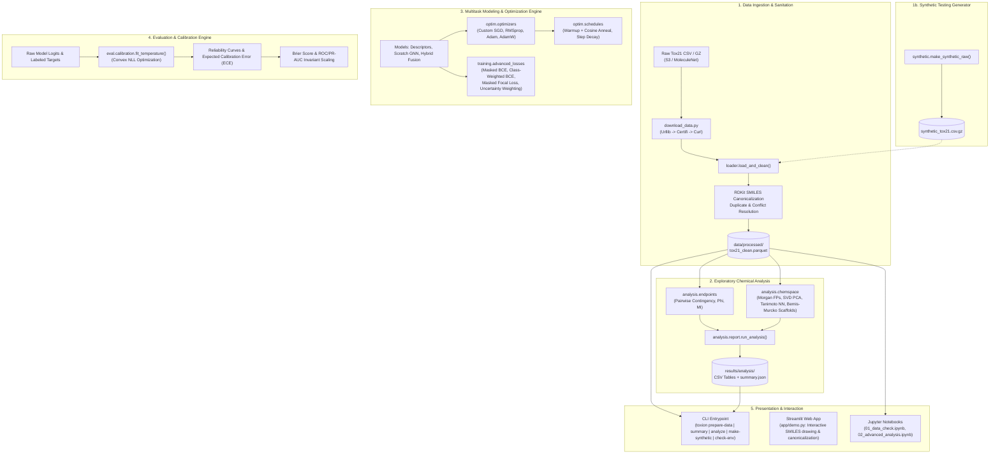

# Toxion — Developer & Theoretical Reference Manual (README_DEV)

Welcome to the internal developer documentation for **Toxion**. This document provides a complete, mathematically rigorous, and architecturally detailed reference covering the entire codebase: system High-Level Design (HLD), Low-Level Design (LLD), from-scratch optimizers and schedules, imbalance-aware multitask loss functions, post-hoc uncertainty calibration, exploratory chemical space analysis, CLI tools, Streamlit demo interface, and current pipeline execution outputs.

---

## Table of Contents
1. [Project Overview & Problem Statement](#1-project-overview--problem-statement)
2. [High-Level Design (HLD)](#2-high-level-design-hld)
3. [Low-Level Design (LLD) & Code Architecture](#3-low-level-design-lld--code-architecture)
4. [Custom First-Order Optimizers & Schedules](#4-custom-first-order-optimizers--schedules)
   - [Why Custom Optimizers?](#why-custom-optimizers)
   - [Optimizer Mechanics & Update Formulations](#optimizer-mechanics--update-formulations)
   - [L2 Regularization vs. Decoupled Weight Decay](#l2-regularization-vs-decoupled-weight-decay)
   - [Learning Rate Schedules](#learning-rate-schedules)
   - [Numerical Verification Against PyTorch Native](#numerical-verification-against-pytorch-native)
5. [Imbalance-Aware Multitask Loss Functions](#5-imbalance-aware-multitask-loss-functions)
   - [Masked Multitask Binary Cross Entropy (BCE)](#masked-multitask-binary-cross-entropy-bce)
   - [Class-Weighted BCE](#class-weighted-bce)
   - [Masked Focal Loss](#masked-focal-loss)
   - [Kendall Homoscedastic Uncertainty Weighting](#kendall-homoscedastic-uncertainty-weighting)
6. [Post-Hoc Probability Calibration](#6-post-hoc-probability-calibration)
   - [Reliability Diagrams & Expected Calibration Error (ECE)](#reliability-diagrams--expected-calibration-error-ece)
   - [Brier Score](#brier-score)
   - [Convex Temperature Scaling (NLL Optimization)](#convex-temperature-scaling-nll-optimization)
7. [Comprehensive Mathematical Formulations & Justifications](#7-comprehensive-mathematical-formulations--justifications)
   - [Endpoint Dependence: Pearson $\phi$ vs Mutual Information](#endpoint-dependence-pearson-phi-vs-mutual-information)
   - [Chemical Space: PCA via SVD on Morgan Bit Fingerprints](#chemical-space-pca-via-svd-on-morgan-bit-fingerprints)
   - [Tanimoto Similarity, Nearest Neighbors & Internal Diversity](#tanimoto-similarity-nearest-neighbors--internal-diversity)
   - [Bemis-Murcko Scaffold Distribution & Shannon Entropy](#bemis-murcko-scaffold-distribution--shannon-entropy)
8. [CLI Reference & Current Phase Outputs](#8-cli-reference--current-phase-outputs)
   - [`toxion check-env`](#toxion-check-env)
   - [`python scripts/download_data.py`](#python-scriptsdownload_datapy)
   - [`toxion make-synthetic`](#toxion-make-synthetic)
   - [`toxion prepare-data`](#toxion-prepare-data)
   - [`toxion summary`](#toxion-summary)
   - [`toxion analyze`](#toxion-analyze)
9. [Streamlit Web Application (`app/demo.py`)](#9-streamlit-web-application-appdemopy)
   - [Architecture & Execution](#architecture--execution)
   - [Current UI Features & Output](#current-ui-features--output)
   - [Phase Roadmap for the UI](#phase-roadmap-for-the-ui)
10. [Test Suite & Quality Verification](#10-test-suite--quality-verification)
11. [Project Metadata & Team Contributors](#11-project-metadata--team-contributors)

---

## 1. Project Overview & Problem Statement

**Toxion** is an end-to-end framework for multitask chemical toxicity prediction on the **Tox21** benchmark dataset. The Tox21 data consortium compiled quantitative high-throughput screening (qHTS) measurements across approximately 12,000 environmental chemicals and drugs tested across 12 distinct toxicological pathways:

### The 12 Tox21 Assays
- **Nuclear Receptor (NR) Signaling Pathways (7 endpoints):**
  1. `NR-AR`: Androgen receptor full length
  2. `NR-AR-LBD`: Androgen receptor ligand binding domain
  3. `NR-AhR`: Aryl hydrocarbon receptor
  4. `NR-Aromatase`: Inhibition of aromatase enzyme
  5. `NR-ER`: Estrogen receptor alpha full length
  6. `NR-ER-LBD`: Estrogen receptor ligand binding domain
  7. `NR-PPAR-gamma`: Peroxisome proliferator-activated receptor gamma
- **Stress Response (SR) Pathways (5 endpoints):**
  8. `SR-ARE`: Antioxidant response element (oxidative stress)
  9. `SR-ATAD5`: Genotoxicity / DNA damage response
  10. `SR-HSE`: Heat shock factor response element
  11. `SR-MMP`: Mitochondrial membrane potential disruption
  12. `SR-p53`: p53 tumor suppressor pathway activation

### Core Biochemical & Machine Learning Challenges

1. **Extreme Class Imbalance:** In biological assays, positive (toxic/active) compounds represent rare events, frequently between 3% and 15% of tested compounds. Standard binary cross-entropy allows dominant negatives to overwhelm gradients.
2. **Missing Label Sparsity (NaN vs. 0):** Molecules were not uniformly assayed across all 12 pathways. Missing assay values represent *untested* compounds ($\text{NaN}$), **not** inactive compounds ($0$). Treating $\text{NaN}$ as $0$ introduces catastrophic false negatives. All loss functions, metrics, and contingency tables must preserve masks.
3. **Chemical Structural Redundancy:** Chemical libraries contain analog series, isomers, and near-duplicates with Tanimoto similarity $> 0.7$. Standard random train/test splits lead to data leakage and overly optimistic test metrics.
4. **Multitask Gradient Conflict:** Some endpoints share biological mechanisms (e.g., `NR-ER` and `NR-ER-LBD`), while others are largely independent or have conflicting signals. Naive multitask learning can suffer from negative transfer or one high-loss task dominating the shared representations.
5. **Overconfidence in Probabilities:** Standard deep neural networks output uncalibrated logits that cannot be trusted directly by toxicologists without rigorous calibration (e.g., temperature scaling).

---

## 2. High-Level Design (HLD)

Toxion follows a modular, decoupled architecture where data ingestion, statistical analysis, model optimization, loss formulation, calibration, and UI presentation interact through clean data contracts.



---

## 3. Low-Level Design (LLD) & Code Architecture

The codebase is organized under `src/toxion` with strict separation of concerns, zero circular dependencies, and lazy import patterns to guarantee fast CLI execution:

```
src/toxion/
├── __init__.py           # Package version definition
├── cli.py                # Unified CLI entrypoint with lazy subcommand loading
├── data/
│   ├── __init__.py
│   ├── loader.py         # SMILES canonicalization, deduplication, Parquet I/O
│   ├── summary.py        # Per-endpoint label distribution & missingness metrics
│   └── synthetic.py      # Chemically plausible synthetic Tox21 generator
├── analysis/
│   ├── __init__.py
│   ├── endpoints.py      # Vectorized 2x2 contingency, phi coefficient, mutual information
│   ├── chemspace.py      # Morgan fingerprinting, SVD PCA, chunked Tanimoto, Murcko scaffolds
│   └── report.py         # Analysis orchestrator, CSV/JSON artifact serialization
├── optim/
│   ├── __init__.py
│   ├── optimizers.py     # Custom SGD, RMSprop, Adam, AdamW subclasses of Optimizer
│   └── schedules.py      # Warmup cosine and step decay multiplicative factors
├── training/
│   ├── __init__.py
│   └── advanced_losses.py # Masked weighted BCE, focal loss, Kendall uncertainty module
└── eval/
    ├── __init__.py
    └── calibration.py    # ECE, Brier score, convex temperature scaling via SciPy
```

### Key Low-Level Design Decisions

1. **Lazy Loading Pattern:** Heavy computational libraries (`torch`, `rdkit`, `pandas`, `scipy`) are imported only inside the respective functions or command handlers in `cli.py`. This ensures `toxion --help` or `toxion check-env` executes in under 50ms even if heavy dependencies are uninstalled or slow to import.
2. **Strict NaN Invariant:** Missing labels are stored as standard IEEE 754 floating-point `NaN` in pandas and PyTorch tensors. All loss computations apply a boolean mask `mask = ~torch.isnan(targets)` and divide exclusively by `mask.sum().clamp(min=1)`.
3. **Chunked Memory Footprint for All-Pairs Tanimoto:** Calculating nearest-neighbor Tanimoto similarity for $N \approx 10,000$ molecules would create an $N \times N$ matrix requiring gigabytes of RAM. `chemspace.nearest_neighbor_similarity` processes rows in configurable chunks (default 1024), maintaining $O(\text{chunk} \times N)$ spatial complexity.
4. **Sign Stabilization for SVD:** SVD decompositions are unique only up to column/row sign flips ($(\mathbf{u}_k, \mathbf{v}_k) \leftrightarrow (-\mathbf{u}_k, -\mathbf{v}_k)$). `pca_svd` enforces a deterministic sign convention by forcing the coordinate with the largest absolute magnitude in each principal component vector to be strictly positive.

---

## 4. Custom First-Order Optimizers & Schedules

### Why Custom Optimizers?

While PyTorch provides production optimizers, Toxion implements first-order optimizers (`SGD`, `RMSprop`, `Adam`, `AdamW`) directly from their foundational update equations for four critical reasons:

1. **Exact Algorithmic Transparency & Control:** Machine learning in specialized biochemical domains requires verifiable control over numerical edge conditions, including sparse gradient rejection, epsilon addition ordering, and in-place tensor buffer mutations.
2. **Dissecting Coupled L2 vs. Decoupled Weight Decay:** Standard PyTorch implementations historically blurred the lines between $L_2$ regularization (adding $\lambda \theta$ to gradient $g$) and true weight decay (shrinking $\theta \leftarrow \theta(1 - \eta \lambda)$). In adaptive methods like Adam, this distinction dramatically alters the regularization of weights with high versus low historical gradient norms. Writing both from scratch validates this mathematical discrepancy.
3. **Rigorous Numerical Proof via PyTorch Test Parity:** Every custom optimizer subclass inherits from `torch.optim.Optimizer` and is tested against native `torch.optim.*` on non-convex multi-parameter regression problems, asserting identical parameter updates up to float64 machine tolerance ($rtol=10^{-7}, atol=10^{-10}$).
4. **Zero Magic:** Ensuring researchers and developers can inspect, step through, and modify the core optimization loop without opaque C++/CUDA bindings.

### Optimizer Mechanics & Update Formulations

#### 1. Stochastic Gradient Descent with Momentum & Nesterov (`SGD`)
For parameter $\theta_t$, gradient $g_t = \nabla_\theta \mathcal{L}(\theta_t)$, learning rate $\eta$, momentum $\mu \in [0, 1)$, and weight decay $\lambda$:

1. **Weight Decay (if $\lambda > 0$):**
   $$g_t \leftarrow g_t + \lambda \theta_t$$
2. **Momentum Accumulation:**
   $$v_t = \begin{cases} g_1 & \text{for } t = 1 \\ \mu v_{t-1} + g_t & \text{for } t > 1 \end{cases}$$
3. **Direction Selection (Standard vs. Nesterov):**
   $$d_t = \begin{cases} g_t + \mu v_t & \text{if Nesterov} \\ v_t & \text{otherwise} \end{cases}$$
4. **Parameter Update:**
   $$\theta_{t+1} \leftarrow \theta_t - \eta d_t$$

*Intuition:* Momentum damps high-curvature oscillations along steep ravine walls while accelerating down gentle slopes. Nesterov accelerated gradient evaluates momentum before computing the gradient step, providing anticipatory damping.

#### 2. Root Mean Square Propagation (`RMSprop`)
Maintains an exponentially decaying average of squared gradients to normalize update magnitudes across heterogeneous parameter scales:

1. **Weight Decay (if $\lambda > 0$):**
   $$g_t \leftarrow g_t + \lambda \theta_t$$
2. **Second Moment Accumulation:**
   $$v_t = \alpha v_{t-1} + (1 - \alpha) g_t^2$$
3. **Parameter Update:**
   $$\theta_{t+1} \leftarrow \theta_t - \frac{\eta}{\sqrt{v_t} + \epsilon} \odot g_t$$

*Intuition:* If a parameter consistently experiences massive gradients, $v_t$ grows large, shrinking its effective step size to prevent explosions. Infrequently updated parameters experience smaller $v_t$, preserving larger steps.

#### 3. Adaptive Moment Estimation (`Adam`)
Combines exponential smoothing of first moments (mean gradient) and second uncentered moments (variance of gradients) with exact finite-sample bias corrections:

1. **L2 Weight Regularization (Coupled):**
   $$g_t \leftarrow g_t + \lambda \theta_t$$
2. **Moment Accumulations:**
   $$m_t = \beta_1 m_{t-1} + (1 - \beta_1) g_t$$
   $$v_t = \beta_2 v_{t-1} + (1 - \beta_2) g_t^2$$
3. **Bias Correction Derivation:**
   Because $m_0 = 0$, expanding $m_t$ reveals:
   $$m_t = (1 - \beta_1) \sum_{i=1}^t \beta_1^{t-i} g_i$$
   Taking expectations under the assumption that gradients $g_i$ come from a stationary distribution with mean $\mathbb{E}[g]$:
   $$\mathbb{E}[m_t] = \mathbb{E}[g] (1 - \beta_1) \sum_{i=1}^t \beta_1^{t-i} = \mathbb{E}[g] (1 - \beta_1) \frac{1 - \beta_1^t}{1 - \beta_1} = \mathbb{E}[g] (1 - \beta_1^t)$$
   Therefore, the unbiased first and second moment estimators are:
   $$\hat{m}_t = \frac{m_t}{1 - \beta_1^t}, \quad \hat{v}_t = \frac{v_t}{1 - \beta_2^t}$$
4. **Parameter Update:**
   $$\theta_{t+1} \leftarrow \theta_t - \frac{\eta}{\sqrt{\hat{v}_t} + \epsilon} \odot \hat{m}_t$$

*Special Property at $t=1$:*
$$\hat{m}_1 = \frac{(1 - \beta_1) g_1}{1 - \beta_1} = g_1, \quad \hat{v}_1 = \frac{(1 - \beta_2) g_1^2}{1 - \beta_2} = g_1^2$$
$$\Delta \theta_1 \approx -\eta \frac{g_1}{\sqrt{g_1^2} + \epsilon} = -\eta \, \text{sign}(g_1)$$
The very first step of Adam is invariant to gradient magnitude and strictly takes a step of size $\eta \cdot \text{sign}(g)$.

### L2 Regularization vs. Decoupled Weight Decay

In `Adam`, weight decay is coupled to the gradient: $g_t \leftarrow g_t + \lambda \theta_t$. This means the effective regularization step is divided by $\sqrt{\hat{v}_t} + \epsilon$:
$$\Delta \theta_{t, \text{decay}} \propto -\frac{\eta \lambda \theta_t}{\sqrt{\hat{v}_t} + \epsilon}$$
- **The Problem:** If a weight receives large historical gradients ($\hat{v}_t \gg 0$), its effective weight decay rate is suppressed toward zero! Conversely, rarely activated weights are decayed aggressively.
- **The AdamW Solution (Loshchilov & Hutter, 2019):**
  Decouple weight decay from gradient updates completely by shrinking parameters *before* or *independent of* the gradient step:
  $$\theta_t \leftarrow \theta_t (1 - \eta \lambda)$$
  Followed by standard Adam update using unregularized gradient $g_t$.
- In `toxion.optim.optimizers`, `AdamW` subclasses `Adam` with `_decoupled_weight_decay = True`, executing `p.mul_(1 - lr * wd)` directly on the parameter tensor.

### Learning Rate Schedules

Toxion implements learning rate modifiers as pure multiplicative factor functions $f(t) \in [0, 1]$ wrapped into PyTorch's `LambdaLR` via `make_scheduler(optimizer, factor_fn)`:

1. **Warmup + Cosine Annealing (`warmup_cosine_factor`):**
   - For initial step $t < W$ (warmup steps):
     $$f(t) = \frac{t + 1}{W}$$
   - For step $t \ge W$ up to total steps $T$:
     $$p = \min\left(1.0, \frac{t - W}{\max(1, T - W)}\right)$$
     $$f(t) = f_{\min} + (1.0 - f_{\min}) \cdot \frac{1}{2} \left(1 + \cos(\pi p)\right)$$
   *Why Warmup Matters:* In the first few iterations, Adam's second moment estimate $v_t$ is noisy and has high variance. Stepping with full learning rate $\eta$ can destabilize weights early. Warmup smoothly ramps from $0$ to $\eta$ while moments stabilize.
2. **Step Decay (`step_decay_factor`):**
   $$f(t) = \gamma^{\lfloor t / s \rfloor}$$
   Multiplies the learning rate by decay rate $\gamma$ (default 0.1) every $s$ steps.

### Numerical Verification Against PyTorch Native

The test suite in `tests/test_optim.py` verifies our custom optimizers against official `torch.optim` classes across 10 configurations:
- `SGD` (Vanilla, with Momentum 0.9, with Nesterov, with Momentum + Weight Decay)
- `RMSprop` (Vanilla, with Alpha 0.9 + Weight Decay)
- `Adam` (Vanilla, with custom Betas + Weight Decay)
- `AdamW` (Vanilla, with decoupled Weight Decay 0.1)

All test cases assert $\max |\theta_{\text{ours}} - \theta_{\text{torch}}| \le 10^{-10}$ across 40 gradient descent iterations on non-convex objectives.

---

## 5. Imbalance-Aware Multitask Loss Functions

Toxion provides four specialized loss mechanisms in `src/toxion/training/advanced_losses.py` specifically designed for sparse, imbalanced multitask toxicological data.

### Masked Multitask Binary Cross Entropy (BCE)

Given batch size $N$, task count $T=12$, logits $z_{it}$, and target labels $y_{it} \in \{0, 1, \text{NaN}\}$:
$$\text{mask}_{it} = \begin{cases} 1 & \text{if } y_{it} \neq \text{NaN} \\ 0 & \text{if } y_{it} = \text{NaN} \end{cases}$$
For labeled entries, let $p_{it} = \sigma(z_{it}) = \frac{1}{1 + e^{-z_{it}}}$. The per-entry loss is:
$$\ell_{it} = -\left[ y_{it} \log p_{it} + (1 - y_{it}) \log(1 - p_{it}) \right]$$
The normalized batch loss divides strictly by total labeled points across all tasks:
$$\mathcal{L}_{\text{BCE}} = \frac{\sum_{i=1}^N \sum_{t=1}^T \text{mask}_{it} \cdot \ell_{it}}{\max\left(1, \sum_{i=1}^N \sum_{t=1}^T \text{mask}_{it}\right)}$$
*Safety Guarantee:* If a batch contains only $\text{NaN}$ values, the function safely returns $0.0$ and generates zero gradients without producing `NaN` or dividing by zero.

### Class-Weighted BCE

To counteract severe positive-class rarity, each task $t$ is assigned a positive multiplier $w_t$:
$$w_t = \text{clip}\left(\frac{N_{\text{neg}, t}}{N_{\text{pos}, t}}, 0.1, 100.0\right)$$
Computed by `compute_pos_weights(y, clip=(0.1, 100.0))`. The loss becomes:
$$\ell_{it}^{\text{weighted}} = -\left[ w_t y_{it} \log p_{it} + (1 - y_{it}) \log(1 - p_{it}) \right]$$
*Critical Note on Calibration:* Weighting positives alters the effective prior odds by $w_t$. Consequently, while ranking metrics like ROC-AUC or PR-AUC improve during training, the model's raw output probabilities become inherently miscalibrated (over-predicting toxicity probabilities). Post-hoc temperature or Platt scaling is required before deploying probabilities.

### Masked Focal Loss

Introduced by Lin et al. (2017) to prevent massive numbers of easy negatives from swamping gradient updates:
Define $p_t$:
$$p_t = \begin{cases} p & \text{if } y = 1 \\ 1 - p & \text{if } y = 0 \end{cases}$$
The focal loss introduces a dynamic modulating factor $(1 - p_t)^\gamma$:
$$\mathcal{L}_{\text{Focal}} = -\alpha_t (1 - p_t)^\gamma \log(p_t)$$
Where $\alpha_t = \alpha$ for positives and $1 - \alpha$ for negatives.
- **Dynamic Downweighting:** If an easy negative has $p_t = 0.99$ and $\gamma = 2$, $(1 - p_t)^2 = (0.01)^2 = 0.0001$. Its gradient contribution is suppressed by $10,000\times$.
- If $p_t = 0.5$ (a hard, ambiguous molecule), $(1 - p_t)^2 = 0.25$, receiving $2,500\times$ more relative weight than the easy example.
- When $\gamma = 0$ and $\alpha = \text{None}$, focal loss simplifies identically to standard BCE.

### Kendall Homoscedastic Uncertainty Weighting

In multitask architectures, different assays have fundamentally different noise levels, label reliabilities, and inherent unpredictability. Kendall et al. (2018) formulated a principled multi-objective loss based on task-dependent homoscedastic uncertainty $\sigma_t^2$:

Let $s_t = \log \sigma_t^2$ be a learnable real-valued scalar parameter per task (instantiated as `nn.Parameter(torch.zeros(n_tasks))` in `UncertaintyWeightedLoss`).

$$\mathcal{L}_{\text{multi}}(\theta, \mathbf{s}) = \sum_{t=1}^T \left[ \exp(-s_t) \mathcal{L}_t(\theta) + \frac{1}{2} s_t \right]$$

#### Mathematical Optimal Weight Derivation
Differentiating with respect to $s_t$:
$$\frac{\partial \mathcal{L}_{\text{multi}}}{\partial s_t} = -\exp(-s_t) \mathcal{L}_t + \frac{1}{2} = 0$$
$$\exp(-s_t^*) \mathcal{L}_t = \frac{1}{2} \implies \exp(s_t^*) = 2 \mathcal{L}_t \implies s_t^* = \log(2 \mathcal{L}_t)$$
The optimal task weight is:
$$W_t^* = \exp(-s_t^*) = \frac{1}{2 \mathcal{L}_t}$$
- Tasks with large loss $\mathcal{L}_t$ (noisy, difficult assays) receive smaller weight $\frac{1}{2 \mathcal{L}_t}$.
- The regularizer term $+\frac{1}{2} s_t$ acts as a penalty barrier, preventing $s_t \to \infty$ (which would trivially send all loss weights to zero).
- In `toxion`, tasks with no labeled entries in a given batch are dynamically masked out of both the loss term and the penalty term.

---

## 6. Post-Hoc Probability Calibration

A toxicity model outputting a probability of $0.80$ must mean that out of 100 compounds assigned that probability, approximately 80 are genuinely toxic. Neural networks trained with cross-entropy are notoriously overconfident. Toxion implements full probability calibration in `src/toxion/eval/calibration.py`.

### Reliability Diagrams & Expected Calibration Error (ECE)

Predictions $p \in [0, 1]$ are partitioned into $B$ equal-width bins $I_b = (\frac{b-1}{B}, \frac{b}{B}]$.
Let $B_b$ be the set of sample indices whose predicted probability falls into bin $I_b$, with $n_b = |B_b|$:
- **Bin Confidence:** $\text{conf}_b = \frac{1}{n_b} \sum_{i \in B_b} p_i$
- **Observed Empirical Frequency:** $\text{freq}_b = \frac{1}{n_b} \sum_{i \in B_b} y_i$

**Expected Calibration Error (ECE):**
$$\text{ECE} = \sum_{b=1}^B \frac{n_b}{N} \left| \text{freq}_b - \text{conf}_b \right|$$
An ECE of $0.0$ signifies a perfectly calibrated model.

### Brier Score
The mean squared difference between predicted probabilities and binary ground truth:
$$\text{Brier} = \frac{1}{N} \sum_{i=1}^N (p_i - y_i)^2$$
Bounded in $[0, 1]$, where lower values indicate sharper, more accurate probabilistic forecasts.

### Convex Temperature Scaling (NLL Optimization)

Following Guo et al. (2017), temperature scaling applies a single scalar temperature $T > 0$ to soften or sharpen logits before the sigmoid link function:
$$\hat{p}_i = \sigma\left(\frac{z_i}{T}\right)$$
Parameterizing by inverse temperature $\beta = \frac{1}{T} = \exp(u)$ to enforce $\beta > 0$:
The negative log-likelihood (NLL) on a held-out validation set is:
$$\text{NLL}(\beta) = -\sum_{i=1}^N \left[ y_i \log \sigma(\beta z_i) + (1 - y_i) \log(1 - \sigma(\beta z_i)) \right]$$
Using the algebraic identity $-\log \sigma(x) = \log(1 + e^{-x}) = \text{softplus}(-x)$:
$$\text{NLL}(\beta) = \sum_{i=1}^N \left[ \text{softplus}(\beta z_i) - y_i \beta z_i \right]$$

#### Convexity Proof & Invariance
The second derivative of $\text{softplus}(\beta z_i)$ with respect to $\beta$ is:
$$\frac{\partial^2}{\partial \beta^2} \text{softplus}(\beta z_i) = z_i^2 \sigma(\beta z_i) (1 - \sigma(\beta z_i)) \ge 0$$
Since it is a sum of convex functions, **$\text{NLL}(\beta)$ is strictly convex in $\beta$**, guaranteeing a single unique global minimum whenever both positive and negative classes exist.
- In `toxion`, `fit_temperature` solves for $u = \log \beta$ using SciPy's bounded scalar optimizer (`minimize_scalar(method='bounded')`).
- **Ranking Invariance:** Since $T > 0$, the function $f(z) = z / T$ is strictly monotonic. For any two predictions $z_a > z_b$, $z_a / T > z_b / T$. Therefore, **ROC-AUC and PR-AUC are mathematically invariant under temperature scaling**.

---

## 7. Comprehensive Mathematical Formulations & Justifications

### Endpoint Dependence: Pearson $\phi$ vs Mutual Information

To assess which assays can benefit from joint multitask transfer, `analysis/endpoints.py` computes pairwise contingency tables over co-assayed molecules.

For endpoints $i$ and $j$, let $n_{ab}$ count molecules with $y_i = a$ and $y_j = b$ for $a, b \in \{0, 1\}$, with total co-labeled $N = n_{00} + n_{01} + n_{10} + n_{11}$.

#### 1. Pearson $\phi$ Coefficient:
$$\phi = \frac{n_{11} n_{00} - n_{10} n_{01}}{\sqrt{(n_{11} + n_{10})(n_{01} + n_{00})(n_{11} + n_{01})(n_{10} + n_{00})}}$$
- $\phi \in [-1, 1]$. It is the exact Pearson correlation coefficient computed over binary variables.
- $\phi^2 \cdot N \sim \chi^2_1$ under the null hypothesis of assay independence.
- *Why used:* Measures directional linear correlation. Strong positive $\phi$ indicates assays that co-activate (e.g. receptor isoforms).

#### 2. Mutual Information (in bits):
$$I(A; B) = \sum_{a \in \{0,1\}} \sum_{b \in \{0,1\}} p(a, b) \log_2 \left(\frac{p(a, b)}{p(a) p(b)}\right)$$
With empirical cell probabilities $p(a, b) = n_{ab} / N$ and $0 \log_2 0 = 0$.
- $I(A; B) \ge 0$, with equality if and only if assays are statistically independent.
- The diagonal $I(A; A) = H(A)$ yields the Shannon entropy of each individual endpoint.
- *Why used:* Mutual information captures non-linear and inverse dependencies where $\phi \approx 0$ might otherwise fail to detect shared representation value.

---

### Chemical Space: PCA via SVD on Morgan Bit Fingerprints

`analysis/chemspace.py` extracts 2048-bit Morgan circular fingerprints (radius = 2, equivalent to ECFP4) using RDKit.

Given binary matrix $\mathbf{X} \in \{0, 1\}^{N \times d}$ ($d = 2048$), compute the centered matrix:
$$\mathbf{X}_c = \mathbf{X} - \mathbf{1} \boldsymbol{\mu}^T, \quad \boldsymbol{\mu} = \frac{1}{N} \mathbf{X}^T \mathbf{1}$$

#### Why Singular Value Decomposition (SVD) instead of Covariance Eigendecomposition?
Forming the sample covariance matrix $\mathbf{C} = \frac{1}{N-1} \mathbf{X}_c^T \mathbf{X}_c$ squares the condition number:
$$\kappa(\mathbf{C}) = \kappa(\mathbf{X}_c)^2$$
For high-dimensional, sparse binary data, squaring the condition number leads to catastrophic loss of numerical precision. Toxion performs economy SVD directly on $\mathbf{X}_c$:
$$\mathbf{X}_c = \mathbf{U} \mathbf{\Sigma} \mathbf{V}^T$$
- **Principal Directions:** Columns of $\mathbf{V}$ (rows of $\mathbf{V}^T$).
- **Variance along $k$-th Component:** $\lambda_k = \frac{\sigma_k^2}{N - 1}$.
- **Explained Variance Ratio:** $\frac{\lambda_k}{\sum_j \lambda_j}$.
- **Uncorrelated Principal Coordinates (Scores):** $\mathbf{Z} = \mathbf{X}_c \mathbf{V} = \mathbf{U} \mathbf{\Sigma}$.

---

### Tanimoto Similarity, Nearest Neighbors & Internal Diversity

For binary bit vectors $\mathbf{a}, \mathbf{b} \in \{0, 1\}^d$, the Tanimoto similarity (Jaccard index) is:
$$T(\mathbf{a}, \mathbf{b}) = \frac{|\mathbf{a} \cap \mathbf{b}|}{|\mathbf{a} \cup \mathbf{b}|} = \frac{\mathbf{a}^T \mathbf{b}}{\mathbf{a}^T \mathbf{a} + \mathbf{b}^T \mathbf{b} - \mathbf{a}^T \mathbf{b}}$$

#### Matrix Implementation:
For a batch $\mathbf{A} \in \{0, 1\}^{N \times d}$:
$$\mathbf{Inter} = \mathbf{A} \mathbf{A}^T$$
$$\mathbf{Union}_{ij} = \sum_k A_{ik} + \sum_k A_{jk} - \text{Inter}_{ij}$$
$$\mathbf{T} = \frac{\mathbf{Inter}}{\mathbf{Union}}$$
If two compounds have no set bits, $T = 0.0$.

#### Metrics:
1. **Nearest-Neighbor Similarity ($NN_i$):**
   $$NN_i = \max_{j \neq i} T(i, j)$$
   If the median of $NN$ is high ($> 0.7$), the dataset contains clusters of structural analogs, warning of optimistic random splits.
2. **Internal Diversity:**
   $$\text{Div} = 1.0 - \frac{1}{N(N-1)} \sum_{i \neq j} T(i, j)$$
   Quantifies overall chemical dispersion across the dataset.

---

### Bemis-Murcko Scaffold Distribution & Shannon Entropy

Every molecule is reduced to its Bemis-Murcko core scaffold (ring systems and linking chains, stripping side chains). Acyclic molecules map to the empty scaffold `""`.

Let $C_s$ be the count of scaffold $s$, with empirical frequency $p_s = \frac{C_s}{N}$.
1. **Scaffold Shannon Entropy (bits):**
   $$H = -\sum_{s} p_s \log_2(p_s)$$
2. **Effective Number of Scaffolds ($N_{\text{eff}}$):**
   $$N_{\text{eff}} = 2^H$$
   $N_{\text{eff}}$ represents the number of equally populated scaffolds required to produce an identical information entropy. If $N_{\text{eff}} \ll \text{Total Scaffolds}$, a tiny minority of scaffold motifs dominates the dataset.

---

## 8. CLI Reference & Current Phase Outputs

Toxion provides a unified CLI through `toxion` (or `python -m toxion.cli`).

### Global Flags
- `--traceback`: Prints the complete Python exception stack trace on failure rather than a single-line sanitized error message.

---

### `toxion check-env`
Validates environment installation and checks available packages across the 7 dependency tiers.

```bash
uv run toxion check-env
```

**Live Output:**
```
python 3.14.2
  [core   ] numpy            2.5.4
  [core   ] pandas           3.0.6
  [core   ] pyarrow          26.0.0
  [core   ] rdkit            2026.9.1
  [core   ] scikit-learn     1.9.1
  [core   ] scipy            1.18.1
  [ml     ] torch            2.14.1
  [ml     ] xgboost          3.4.1
  [gnn    ] torch-geometric  MISSING (install extra: gnn)
  [explain] captum           MISSING (install extra: explain)
  [demo   ] streamlit        1.66.1
  [notebook] jupyterlab       4.6.4
  [notebook] matplotlib       3.11.2
  [dev    ] pytest           9.1.1
```

---

### `python scripts/download_data.py`
Standard-library automated data fetcher with multi-tier TLS certificate fallback.
- **Urllib download** -> On SSL failure, retries with `certifi` CA bundle -> On secondary failure, shells out to system `curl` -> Validates gzip magic header `\x1f\x8b`.
- **Destination:** `data/raw/tox21.csv.gz`

---

### `toxion make-synthetic`
Generates synthetic Tox21-shaped data with correlated multi-task labels based on aromatic/halogen/nitro latent rules.

```bash
uv run toxion make-synthetic --n 400 --out data/raw/synthetic_tox21.csv.gz
```

**Live Output:**
```
Wrote 400 SYNTHETIC molecules to data/raw/synthetic_tox21.csv.gz (not real data; never report results from it)
Next (synthetic data only, separate output paths so it is never mixed with the real data):
  toxion prepare-data --raw-path data/raw/synthetic_tox21.csv.gz --out-path data/processed/synthetic_clean.parquet
  toxion summary --clean-path data/processed/synthetic_clean.parquet
  toxion analyze --clean-path data/processed/synthetic_clean.parquet --out-dir results/analysis_synthetic
```

---

### `toxion prepare-data`
Performs data sanitation, RDKit canonicalization, invalid structure removal, and duplicate/conflict resolution.

```bash
uv run toxion prepare-data --raw-path data/raw/synthetic_tox21.csv.gz --out-path data/processed/synthetic_clean.parquet
```

**Output:**
```
2026-10-24 16:02:35,673 INFO Clean dataset: 200 molecules, 12 tasks
Wrote 200 clean rows to data/processed/synthetic_clean.parquet
```

---

### `toxion summary`
Generates comprehensive missingness and class balance statistics per endpoint.

```bash
uv run toxion summary --clean-path data/processed/synthetic_clean.parquet
```

**Live Output:**
```
molecules: 200
labeled entries: 1738 of 2400 (27.6% missing)
mean labels per molecule: 8.69
molecules with no labels: 0

               labeled  missing  missing_pct  positives  negatives  positive_rate
NR-AR              147       53         26.5         89         58          0.605
NR-AR-LBD          153       47         23.5         25        128          0.163
NR-AhR             157       43         21.5         39        118          0.248
NR-Aromatase       113       87         43.5         18         95          0.159
NR-ER              163       37         18.5         89         74          0.546
NR-ER-LBD          138       62         31.0         86         52          0.623
NR-PPAR-gamma      174       26         13.0         66        108          0.379
SR-ARE             116       84         42.0         40         76          0.345
SR-ATAD5           122       78         39.0         50         72          0.410
SR-HSE             168       32         16.0         75         93          0.446
SR-MMP             115       85         42.5         64         51          0.557
SR-p53             172       28         14.0         35        137          0.203
```

---

### `toxion analyze`
Executes the advanced chemical space and multi-task correlation engine, writing full tabular and JSON artifacts.

```bash
uv run toxion analyze --clean-path data/processed/synthetic_clean.parquet --out-dir results/analysis_synthetic
```

**Live Output:**
```
molecules analyzed: 200
PCA: top-3 variance ratio [0.105, 0.053, 0.049], 92 components for 90% variance
nearest-neighbor Tanimoto: mean 0.474, median 0.471, 0.0% above 0.7
internal diversity (1 - Tanimoto): 0.907
scaffolds: 6 distinct, largest group 18.5%, effective number 6.0
tables written to results/analysis_synthetic
```

#### Generated Artifacts in `results/analysis/`:
1. `endpoints_phi.csv`: $12 \times 12$ Pearson correlation matrix.
2. `endpoints_mi_bits.csv`: $12 \times 12$ mutual information matrix in bits.
3. `endpoints_colabeled.csv`: $12 \times 12$ matrix of co-assayed molecule counts.
4. `pca_variance.csv`: Table of principal components, explained variance ratios, and cumulative variance.
5. `pca_scores_top2.csv`: Per-molecule coordinates along PC1 and PC2.
6. `scaffold_top.csv`: Top Murcko scaffolds and absolute counts.
7. `summary.json`: Complete serialized metrics summary:

```json
{
  "n_molecules": 200,
  "fingerprint": {
    "type": "morgan_bits",
    "radius": 2,
    "n_bits": 2048
  },
  "pca": {
    "variance_ratio_top": [
      0.10480948880758369,
      0.053172577342511504,
      0.04912596950318122
    ],
    "components_for_90pct_variance": 92
  },
  "nearest_neighbor_tanimoto": {
    "mean": 0.47434207797050476,
    "median": 0.47058823704719543,
    "p10": 0.36000001430511475,
    "p90": 0.6129032373428345,
    "fraction_above_0.7": 0.0
  },
  "internal_diversity": 0.9074104947518165,
  "scaffolds": {
    "n_molecules": 200,
    "n_scaffolds": 6,
    "n_acyclic": 0,
    "singleton_scaffolds": 0,
    "largest_group_fraction": 0.185,
    "top_k_fraction": 1.0,
    "entropy_bits": 2.579297415078986,
    "effective_n_scaffolds": 5.976485768486213
  }
}
```

---

## 9. Streamlit Web Application (`app/demo.py`)

### Architecture & Execution

The Streamlit web application is located at `app/demo.py` and provides an interactive graphical interface for chemical structure validation, canonicalization, and 2D rendering.

```bash
uv sync --extra demo
uv run streamlit run app/demo.py
```

It is also configured for zero-downtime deployment on **Render** via `render.yaml`:
```yaml
services:
  - type: web
    name: toxion-demo
    runtime: python
    buildCommand: pip install -e ".[demo]"
    startCommand: streamlit run app/demo.py --server.port $PORT --server.address 0.0.0.0
    envVars:
      - key: PYTHON_VERSION
        value: 3.14.3
```

### Current UI Features & Output

1. **Title & Header:**
   - App title: `# Toxion`
   - Subtitle caption: `SMILES canonicalization and structure drawing.`
2. **Interactive Chemical Input:**
   - A single-line text input field pre-filled with benzene (`c1ccccc1`).
   - Accepts arbitrary SMILES strings (e.g. `CC(=O)Oc1ccccc1C(=O)O` for Aspirin, `CN1C=NC2=C1C(=O)N(C(=O)N2C)C` for Caffeine).
3. **Execution Trigger:**
   - Primary `Canonicalize` button.
4. **Validation & Rendering Engine:**
   - Calls `toxion.data.loader.canonicalize_smiles(input_string)`.
   - **On Error:** Displays a red Streamlit error message: `RDKit could not parse this SMILES string.`
   - **On Success:**
     - Displays `### Canonical SMILES` followed by a copyable monospace code block containing the standardized canonical representation.
     - Uses RDKit's 2D coordinate engine and `rdkit.Chem.Draw.MolToImage` to dynamically generate and render a high-resolution $400 \times 400$ PNG image of the 2D molecular graph structure.

### Phase Roadmap for the UI

In subsequent development phases, `app/demo.py` is architected to expand into:
1. **Multi-Model Toxicity Scoreboard:** Input a SMILES string to receive calibrated probability predictions across all 12 endpoints from:
   - Morgan Fingerprint + XGBoost baseline
   - Scratch Message Passing GNN
   - Hybrid Fusion (Graph + ChemSpace Descriptors)
2. **Interactive Radar / Spider Chart:** A 12-axis radial chart visualizing pathway activation risk profiles (Nuclear Receptor vs. Stress Response).
3. **Substructure Attribution Highlighting:** Color-coding individual chemical atoms and bonds responsible for predicted toxicity using Captum integrated gradients.
4. **Chemical Space Projection Viewer:** An interactive t-SNE / PCA scatter plot showing where the user's input molecule lands relative to the entire Tox21 reference library.

---

## 10. Test Suite & Quality Verification

Toxion features comprehensive unit and numerical verification tests in `tests/`:

```
============================= test session starts ==============================
rootdir: /Users/Utkarsh/Downloads/toxion
configfile: pyproject.toml
collected 83 items

tests/test_advanced_losses.py ..........                                 [ 12%]
tests/test_analysis_cli.py ..                                            [ 14%]
tests/test_calibration.py .......                                        [ 22%]
tests/test_chemspace.py .........                                        [ 33%]
tests/test_download_script.py .......                                    [ 42%]
tests/test_endpoints.py .....                                            [ 48%]
tests/test_loader.py .............                                       [ 63%]
tests/test_optim.py ...................                                  [ 86%]
tests/test_summary_and_cli.py .........                                  [ 97%]
tests/test_synthetic.py ..                                               [100%]

============================== 83 passed in 5.74s ==============================
```

### Coverage Highlights
- `test_optim.py`: Verifies numerical identity of `SGD`, `RMSprop`, `Adam`, `AdamW` with PyTorch, verifies step 1 sign dynamics, validates zero-gradient decay in AdamW, checks warmup and cosine schedules.
- `test_advanced_losses.py`: Confirms masked BCE ignores NaNs, checks focal loss easy-example downweighting, verifies Kendall uncertainty gradient updates and analytical minimum $\log(2 \mathcal{L}_t)$.
- `test_calibration.py`: Tests numerically stable sigmoid, hand-computed ECE bins, Brier scores, and proves temperature scaling preserves ROC-AUC.
- `test_chemspace.py`: Validates deterministic SVD signs, Tanimoto matrix symmetry, and Bemis-Murcko entropy formulas.
- `test_loader.py`: Verifies canonicalization, invalid SMILES dropping, and conflict detection logic.

---

## 11. Project Metadata & Team Contributors

- **Repository:** `https://github.com/ElusiveParadox/toxion.git`
- **Owner:** Aditya Kishore (`ElusiveParadox`) — `adityakishore9206@gmail.com`

### Team Contributors
| Contributor | GitHub Handle | Email Contact |
|---|---|---|
| **Project Lead** | `ElusiveParadox` | `adityakishore9206@gmail.com` |
| **Member 1** | `Vidhisinghal0101` | `Vidhisinghal102@gmail.com` |
| **Member 2** | `sushantguri` | `sushantv355@gmail.com` |
| **Member 3** | `manjeet090223` | `manjeet090223@gmail.com` |
| **Member 4** | `aryanx82` | `aryan.yadav2024@nst.rishihood.edu.in` |

---
*For inquiries, issues, or pull requests, please open an issue on the official GitHub repository.*
